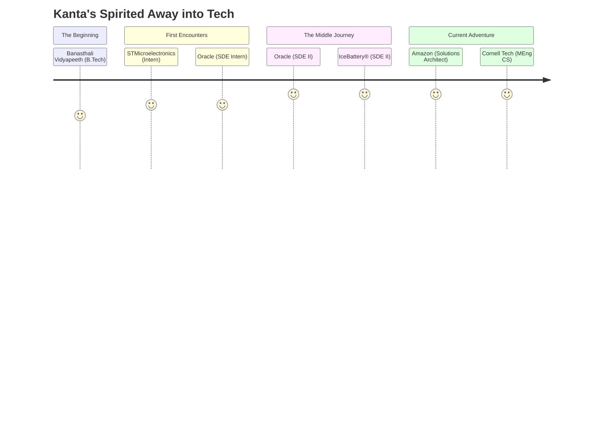

<!-- ╭──────────────────────────────────────────────────────────╮
     │   Kanta's Enchanted Tech Forest · a Studio Ghibli story  │
     ╰──────────────────────────────────────────────────────────╯ -->

 

 

## 🌱 The Wandering Spirit Coder

Namaste! I'm **Kanta** — like Chihiro, I wandered into a spirit world and decided to stay. Mine is made of
cloud architectures and generative AI, and just as Howl builds his moving castle from impossible parts,
I turn wild ideas into systems that actually ship.

|     | The Journey So Far |
| --- | --- |
| 🍄 **Current Adventure** | Solutions Architect @ **Amazon** — crafting Generative AI wonders |
| 🌊 **Previous Voyages** | Software Developer II @ **IceBattery®** and **Oracle** |
| 🌟 **Spirit Guide For** | Women in STEM — making the coding realm open to all wanderers |
| 🌿 **Founded** | **Women in AI/ML — Nashville Chapter**, a sanctuary for tech explorers |
| 🦉 **Knowledge Sharing** | Guest Speaker @ Vanderbilt University · Presenter @ AWS re:Invent |
| 🐱 **My Catbus** | Carrying ideas between human needs and technical solutions |

## 🏯 Current Quest

**🩸 Connectivity-aware 3D vessel segmentation** — teaching a 3D U-Net not to leave blood vessels in
disconnected pieces (Dice + clDice loss, MONAI/PyTorch), with an interactive viewer for slices, error
maps, metrics, and 3D vessel trees · *Cornell Tech, CS5787 Deep Learning*

## 🧙‍♀️ The Magical Grimoire

**✦ spells I cast daily ✦**

📜 &nbsp;Open the full grimoire (every spell &amp; incantation)

 

### 🔮 Generative AI Sorcery

### 🏯 Cloud Architecture

### 🌈 Full-Stack Enchantments

### 🎨 UX Design Artistry

### 🌊 Programming Rivers

## 🍃 Journey Through the Magical Forest

## 🌸 Treasures Found Along the Way

| | |
|---|---|
| 🏆 **AWS Certified Solutions Architect** | like finding Laputa's crystal |
| 🦉 **AWS re:Invent Presenter** | sharing wisdom like Zeniba |
| 🎓 **Vanderbilt University Guest Lecturer** | teaching young spirits of the tech forest |
| 🌈 **Pratibha Eaton Excellence Awards** | acknowledged by the forest spirits |
| 🔮 **Architecting with Google Compute Engine** | a spell learned from the cloud spirits |
| 🏯 **Google Cloud Essentials** | castles built in the digital sky |
| 🌱 **National Scholarship** | a gift carried in by the wind |

## 🌿 Languages of Different Realms

🇮🇳 **Hindi** · native as a forest spirit &nbsp;|&nbsp; 🇺🇸 **English** · fluent as flowing water &nbsp;|&nbsp; 🇫🇷 **French** · visiting through Howl's doors &nbsp;|&nbsp; 🇰🇷 **Korean** · learning the whispers

### ✨ Let's build something as magical as Howl's Moving Castle ✨

<!-- soot sprites scurrying across the footer (transparent) -->

