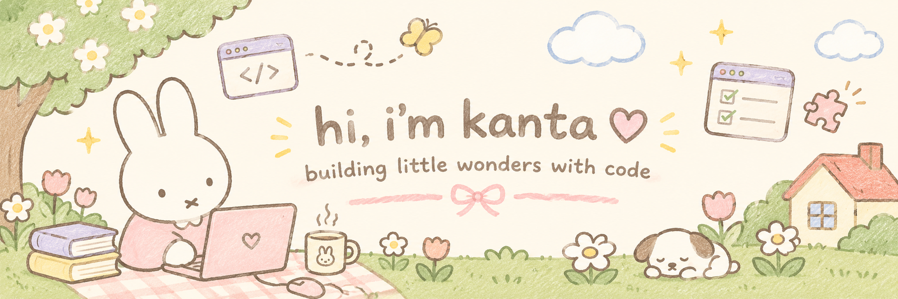
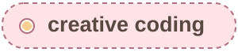
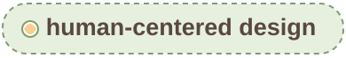
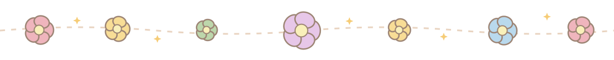
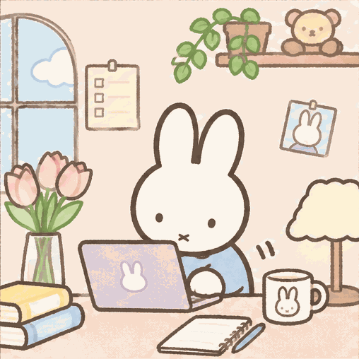
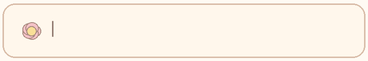

<div align="center">



<br>

**hi, welcome to my little corner of the internet!** 🌷

*cloud architecture · AI/ML · creative coding · little ideas with big hearts*





</div>



## 🌼 a little about me

<table><tr><td width="67%" valign="top">

hi! i'm **kanta**, a solutions architect who likes making technology feel a little more human. ♡

- ☁️ i love **cloud architecture**, **generative AI** and building things that actually help people
- 🧸 i'm happiest when **engineering + creativity + thoughtful design** meet
- 🌱 i care about **learning out loud**, sharing knowledge and making STEM feel welcoming
- ✨ currently collecting ideas for playful, meaningful tech projects

*think curious engineer, cozy desk, a hundred tiny doodles in the notebook.*

</td><td width="33%" align="center" valign="middle">



</td></tr></table>


## 🧺 little things i'm growing



| 🌷 little project | 💭 what i'm exploring |
| :-- | :-- |
| **Style Mirror** | a playful themed outfit face-off where two looks compete for one crown 👑 |
| **Cloud + GenAI experiments** | turning ambitious ideas into useful, approachable experiences |
| **Creative interfaces** | combining code, interaction and delight in the details |

> *Not every little seed is a finished project yet, and that's okay.* 🌱


## 🖍️ what's in my pencil case?

<div align="center">


</div>

**things i enjoy working with:** Python · cloud services · generative AI · machine learning · application architecture · UX thinking

**things i'm always learning:** making better prototypes · accessible interfaces · playful interactions · explaining complicated topics simply


## 🧩 tiny coding garden: solve a puzzle!

**The bunny's flower printer 🌸**

What does this Python snippet print?

```python
flowers = ['🌷', '🌼', '🌸']
print(flowers[-1] * 2)
```

<details>
<summary>🌷 open the little garden gate to reveal the answer</summary>

<br>

**🌸🌸** — `flowers[-1]` takes the last flower, then `* 2` repeats it twice! 🎉

*you earned two virtual flowers for your desk.*

</details>


## 💌 send a little hello

<div align="center">

if you love AI, cloud, thoughtful design or tiny rabbits, we're probably going to get along. ♡

[**github**](https://github.com/kantagarg17) · [**linkedin**](https://www.linkedin.com/in/kantagarg17/) · [**medium**](https://medium.com/@kantagarg17)

*thank you for wandering through my little garden!* 🌻

</div>


